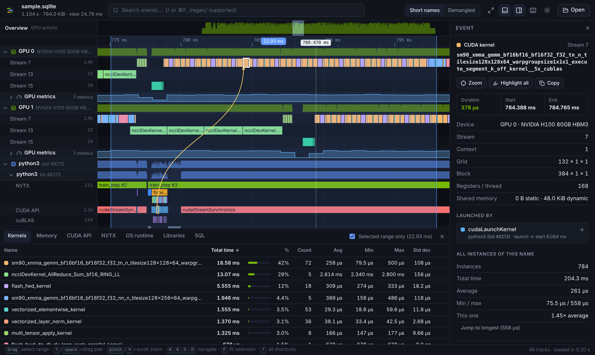

# Nsight Systems Web Viewer

A fast, modern, in-browser viewer for **NVIDIA Nsight Systems** profiles. Drop in a profile and explore GPU kernels, memory transfers, CUDA API calls, NVTX ranges, OS runtime calls and GPU metrics on a smooth, zoomable timeline. Everything runs locally on your machine.



## Features

- **Timeline** of every GPU (per stream) and every CPU process and thread, with nested NVTX, CUDA API, cuBLAS/cuDNN, MPI and OS runtime rows.
- **Smooth at scale.** Canvas rendering with level-of-detail merging stays at 60 fps on millions of events (tested with a 158 MB export holding 3.9 million rows).
- **Launch links.** Click a kernel to see the `cudaLaunchKernel` that queued it, drawn as an arrow, with the launch-to-start latency. Click an API call to see the GPU work it launched.
- **Details panel** showing grid and block sizes, registers, shared memory, bytes and throughput, NVTX payloads, call stacks (when captured) and every raw column.
- **Statistics** for kernels, memory, CUDA API, NVTX, OS runtime and libraries: total, share, count, average, min, max and standard deviation. Restrict them to a selected time range, and click a row to highlight every instance.
- **Range analysis.** Drag across the timeline to see its duration, GPU utilisation and the top kernels in that window.
- **Search** event names by substring or `/regex/`, then step through the matches.
- **SQL console** for running any query against the export, with ready-made recipes.
- **GPU metrics** (SM active, tensor active, DRAM bandwidth and more) shown as counter tracks when the profile has them.
- **Mac-friendly controls:** pinch to zoom, two-finger swipe to pan, plus WASD keys. Dark and light themes.
- **Private.** Profiles are parsed in your browser by a WebAssembly build of SQLite and never leave your computer.

## Quick start (macOS)

You need [Node.js](https://nodejs.org) 20.19+ or 22.12+ (`brew install node`).

```bash
git clone https://github.com/legchikov/nsys-web-viewer.git
cd nsys-web-viewer
npm install
npm start          # builds, then opens http://localhost:4173
```

Drop a profile onto the page, or click **Open the sample profile** to try it straight away.

For development with hot reload, run `npm run dev` and open http://localhost:5173.

## Opening profiles

The viewer reads the **SQLite export** of a report. There are two ways to get one.

**1. Export with `nsys`** on the machine where you profiled (or anywhere Nsight Systems is installed):

```bash
nsys export --type sqlite --output report.sqlite report.nsys-rep
# or export while profiling:
nsys profile --trace cuda,nvtx,osrt --export sqlite -o report python train.py
```

Then drop `report.sqlite` into the viewer.

**2. Drop the `.nsys-rep` directly.** The local server converts it by running `nsys export` for you, provided it can find the `nsys` command-line tool. It looks in this order:

1. the `NSYS_PATH` environment variable (`NSYS_PATH=/path/to/nsys npm start`)
2. your `PATH`
3. `/Applications/NVIDIA Nsight Systems*.app/Contents/…` on macOS, and `/opt/nvidia/nsight-systems/…` on Linux

The landing page shows whether `nsys` was found. Not every Nsight Systems package includes the command-line tool, so if it isn't found on your Mac, export on the Linux machine instead (option 1).

## Navigating

| Action | How |
| --- | --- |
| Zoom | Pinch, ⌘/Ctrl + scroll, or **W** / **S** (hold Shift for faster) |
| Pan | Two-finger swipe sideways, **A** / **D**, ⌥-drag or Space-drag, or drag the overview bar |
| Select an event | Click (double-click zooms to it). **←** / **→** step along the same row |
| Select a time range | Drag on the timeline or the ruler |
| Fit selection / everything | **F** / **0** |
| Search | **/** or ⌘F. **Enter** / **Shift+Enter** for next / previous match |
| Clear | **Esc** clears the selection, then the range, then the search |
| All shortcuts | **?** |

Click a group header to collapse or expand it. Collapsed groups still show an activity summary, so you can keep idle threads out of the way.

## What is shown

| Timeline row | Source table(s) |
| --- | --- |
| GPU → Stream *n* | `CUPTI_ACTIVITY_KIND_KERNEL`, `…_MEMCPY`, `…_MEMSET`, `…_GRAPH_TRACE` |
| GPU → GPU metrics | `GPU_METRICS`, `TARGET_INFO_GPU_METRICS` |
| Thread → NVTX (one row per domain) | `NVTX_EVENTS` (push/pop and start/end ranges, marks) |
| Thread → CUDA API | `CUPTI_ACTIVITY_KIND_RUNTIME` |
| Thread → OS runtime | `OSRT_API` |
| Thread → cuBLAS, cuDNN, MPI, OpenMP, UCX, … | `CUBLAS_EVENTS`, `CUDNN_EVENTS`, `MPI_*`, `OPENMP_*`, … (any table with `start`, `end`, `globalTid` and a name) |

Names come from `StringIds`. Processes, threads and GPUs are labelled from `PROCESSES`, `ThreadNames`, `TARGET_INFO_GPU` and `TARGET_INFO_CUDA_DEVICE`. The loader checks which tables and columns exist, so exports from older and newer Nsight Systems versions both work. Anything it can't read is skipped and listed in the profile summary.

## Limits and tips

- The whole SQLite file is loaded into browser memory. Files up to roughly 1–1.5 GB work well in Chrome. For longer runs, capture a shorter window with `nsys profile --delay … --duration …` or `--capture-range=cudaProfilerApi` / `nvtx`.
- CPU sampling, thread scheduling and backtrace flame graphs are not shown yet. You can still query them in the SQL tab.
- Timestamps are shown relative to the start of the capture session.

## How it works

```
index.html → React app (src/)
  ├─ worker/db.worker.ts   sql.js (SQLite → WebAssembly) opens the export, reads each table into
  │                         compact typed arrays, nests events into rows, keeps the DB open for
  │                         details and SQL
  ├─ timeline/             canvas renderer: binary search over sorted rows, sub-pixel events
  │                         merged into one column per pixel, so cost scales with pixels, not events
  ├─ components/           landing page, top bar, details, statistics, SQL console
  └─ model/                types, layout, colours, statistics, search
server/                    zero-dependency Node server: serves dist/ and POST /api/convert
                           (runs `nsys export` for .nsys-rep uploads, bound to 127.0.0.1)
```

## Development

```bash
npm run dev         # Vite dev server with hot reload (includes the /api helpers)
npm run build       # type-check and build to dist/
npm run serve       # serve an existing build
npm run sample      # regenerate public/sample.sqlite
python3 scripts/make_sample.py --out /tmp/big.sqlite --steps 400 --layers 48   # a large synthetic profile
```

`scripts/make_sample.py` writes a synthetic export with the same tables and columns as `nsys export`. It imitates a two-rank PyTorch DDP training loop: NVTX ranges, kernel launches from the main and autograd threads, NCCL all-reduce on a separate stream, copies, memsets, OS runtime calls and GPU metrics. Use it for demos and testing.
